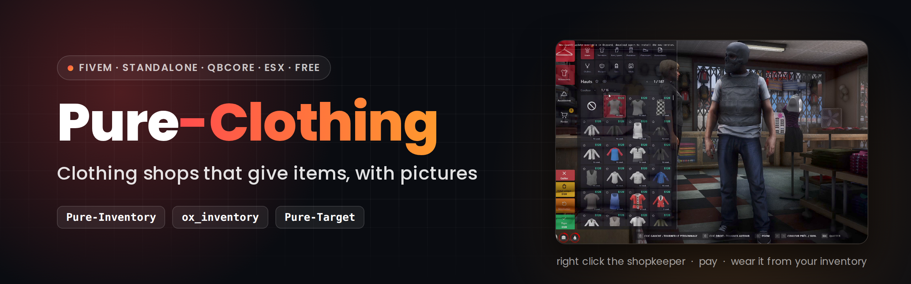

<details name="langue">
<summary><picture></picture></summary>

<div align="center">

<sub>🧩 <b>Suite Pure</b> &nbsp;·&nbsp; <a href="https://github.com/ma3iich/pure-target">Pure-Target</a> (menu clic droit) &nbsp;·&nbsp; <a href="https://github.com/ma3iich/pure_inventory">Pure Inventory</a> (inventaire) &nbsp;·&nbsp; <b>Pure Clothing</b> (vêtements) &nbsp;—&nbsp; chacun marche seul, et ils marchent ensemble</sub>



<br>

**Des magasins de vêtements pour FiveM où chaque vêtement acheté arrive dans l'inventaire en objet, avec sa photo.**<br>
On le porte, on l'enlève, on le donne, on le revend. Standalone, QBCore, Qbox ou ESX · pure_inventory ou ox_inventory.

[](https://fivem.net)
[](https://www.lua.org)
[](#-installation)
[](LICENSE)
[](https://github.com/ma3iich/pure_clothing/releases)
[](https://discord.gg/C4jc8k3dD9)

**[⬇️ Télécharger](https://github.com/ma3iich/pure_clothing/releases/latest)** &nbsp;·&nbsp;
**[📦 Installation](#-installation)** &nbsp;·&nbsp;
**[⚙️ Configuration](#%EF%B8%8F-configuration)** &nbsp;·&nbsp;
**[🧵 Packs de vêtements](#-packs-de-vêtements-addons)** &nbsp;·&nbsp;
**[🔌 Exports](#-exports)** &nbsp;·&nbsp;
**[❓ FAQ](#-faq)**

<sub>Fait par <a href="https://github.com/ma3iich">ma3iich</a></sub>

</div>

---

## 🎬 Aperçus

<table>
  <tr>
    <th width="50%">🛍️ Le magasin</th>
    <th width="50%">🎒 Dans l'inventaire</th>
  </tr>
  <tr>
    <td><!-- video:2-clothing-shop --></td>
    <td><!-- video:3-inventory --></td>
  </tr>
</table>

---

## ✨ Fonctionnalités

<table>
  <tr>
    <td width="50%">🛍️ <b>Un vrai magasin</b><br><sub>Un rayon par type de vêtement, une vignette avec la photo de chaque pièce, les couleurs, le prix. On essaie sur son perso, on tourne autour, on zoome, on masque le haut pour choisir le tee-shirt dessous.</sub></td>
    <td width="50%">👕 <b>Un vêtement = un objet</b><br><sub>Payé, il arrive dans l'inventaire avec sa photo. On le porte depuis l'inventaire, on l'enlève, on le donne, on le revend, on le range dans un coffre.</sub></td>
  </tr>
  <tr>
    <td>🧵 <b>Natif / Nouveautés</b><br><sub>Les 4 758 vêtements du jeu sont livrés avec leur photo. Un pack addon apparaît tout seul dans l'onglet « Nouveautés », sans rien écrire.</sub></td>
    <td>🩲 <b>En caleçon, jamais bugué</b><br><sub>Haut enlevé = torse nu, bras nus ; pantalon enlevé = caleçon ; chaussures enlevées = pieds nus. Les manches suivent le haut, les vrais gants sont une pièce à part.</sub></td>
  </tr>
  <tr>
    <td>🔁 <b>Rien ne se perd, rien ne se duplique</b><br><sub>Ce qu'on porte est connu du serveur : à la reconnexion, le script repasse derrière le script d'apparence. Un autre script qui déshabille (menu radial…) transforme la pièce en objet ; s'il la remet, l'objet est repris.</sub></td>
    <td>🔌 <b>Standalone ou avec ta base</b><br><sub>Détecte QBCore, Qbox, ESX (argent, personnage) ou tourne sans framework. Donne les objets à pure_inventory ou ox_inventory. S'ouvre avec Pure-Target, ox_target, qb-target ou la touche E.</sub></td>
  </tr>
  <tr>
    <td>🎨 <b>Ton rendu dans un seul fichier</b><br><sub>Logo, couleurs, taille, nombre de colonnes, boutons affichés, favoris, barre d'aide : tout est dans <code>config.lua</code>.</sub></td>
    <td>🏷️ <b>Prix comme tu veux</b><br><sub>Par type de vêtement, par magasin (×3 pour le luxe), par pièce ou par plage de numéros (ton pack à 500 $), liste noire pour les uniformes.</sub></td>
  </tr>
</table>

Français et English (`locales/`).

---

## 📋 Dépendances

| Ressource | Obligatoire | Remarques |
| --- | --- | --- |
| [oxmysql](https://github.com/overextended/oxmysql) | ✅ | enregistre ce que chaque personnage porte |
| Serveur FiveM | ✅ | artifact 6116 ou plus récent |
| [pure_inventory](https://github.com/ma3iich/pure_inventory) **ou** [ox_inventory](https://github.com/overextended/ox_inventory) | ✅ (l'un des deux) | reçoit les objets vêtements |
| qb-core / qbx_core / es_extended | facultatif | sans framework : mode standalone |
| [pure-target](https://github.com/ma3iich/pure-target), ox_target ou qb-target | facultatif | sinon : touche E devant le vendeur |
| ox_lib | facultatif | notifications plus jolies |

---

## 📦 Installation

1. Télécharge la [dernière version](https://github.com/ma3iich/pure_clothing/releases/latest) et mets le dossier `pure_clothing` dans tes `resources`.
2. Dans `server.cfg`, **après** ton framework et ton inventaire :
   ```cfg
   ensure oxmysql
   ensure qb-core          # ou qbx_core / es_extended, rien en standalone
   ensure pure_inventory   # ou ox_inventory
   ensure pure_clothing
   ```
3. **Avec pure_inventory :** rien d'autre à faire. L'objet `clothing` existe déjà, les cases de vêtements montrent la photo de la pièce portée, et le glisser-déposer met / enlève les vêtements.
4. **Avec ox_inventory :** dans `ox_inventory/data/items.lua`, remplace l'objet `clothing` déjà présent par celui-ci (ou ajoute-le) :
   ```lua
   ['clothing'] = {
       label = 'Clothing',
       weight = 0,
       stack = false,
       close = false,
       consume = 0,
       client = {
           export = 'pure_clothing.useClothing',
       },
   },
   ```
   Clic droit sur un vêtement > **Utiliser** = le porter. Commande **`/wardrobe`** (ou une touche dans les paramètres FiveM) = la garde-robe, pour enlever une pièce.
5. **Coupe les magasins de vêtements gratuits** de ton script d'apparence (illenium-appearance, qb-clothing…) : garde la création du personnage, le coiffeur et le tatoueur. Sinon un joueur s'habille gratuitement là-bas et revend les pièces.
6. **QBCore, menu radial :** la partie « Vêtements » du menu radial déshabille sans passer par l'inventaire. Le dossier [`qb-radialmenu/`](qb-radialmenu/) contient la config de qb-radialmenu sans cette partie (mode d'emploi dedans). Avec ox_inventory, Pure Clothing gère aussi ce menu (pièce retirée = objet, pièce remise = objet repris).
7. Démarre le serveur : la table `pure_clothing_worn` se crée toute seule. Ouvre `config.lua` pour les magasins, les prix et le rendu.

**Standalone :** les joueurs sont reconnus par leur licence FiveM et payent avec l'objet `money` de l'inventaire.

**Tu as déjà ton magasin de vêtements ?** `Config.EnableShops = false` : plus de PNJ ni de menu, mais tout le reste (objets, garde-robe, photos, sous-vêtements, reconnexion). Ton magasin donne les objets avec [l'export `GiveClothing`](#-exports).

---

## ⚙️ Configuration

Tout est dans **`config.lua`**, avec un commentaire sur chaque réglage :

| Partie | Ce que tu règles |
| --- | --- |
| Général | langue, framework (`auto`), inventaire (`auto`), nom de l'objet, contrôle des mises à jour (`CheckUpdates`), traces (`Debug`) |
| Rendu du menu | **logo** (ton image dans `web/`, `Config.Logo = 'logo.png'`), couleurs (`Config.Theme` : accent, fonds, vignettes, texte, prix), **taille** (`Scale`), colonnes, boutons et fonctions affichés (`Config.Menu` : favoris, œil, étiquette Nouveau, barre d'aide, Achat unique, Réinitialiser) |
| Magasins | `Config.EnableShops`, paiement (liquide / banque), touche et distance d'ouverture, et pour chaque magasin : nom, PNJ (position, modèle), point sur la carte, **rayons vendus**, **multiplicateur de prix** |
| Vêtements et prix | `Config.Slots` : un type de vêtement par ligne (retire la ligne pour ne jamais le vendre), avec son prix et son poids ; `Config.Prices` : prix par pièce ou par plage de numéros ; `Config.Blacklist` : jamais vendu |
| Sous-vêtements | valeurs « nu » par sexe (`Config.Naked`), autres numéros qui comptent comme « nu » (`Config.BareDrawables`, dont ceux de qb-radialmenu), remise des vêtements à la connexion (`ApplyDelay`, `ApplyTimeout`), pièce retirée par un autre script = objet (`AutoTakeOff`) |
| Caméra | champ de vision, distances et hauteurs du zoom |

---

## 👕 Comment ça marche

- **Au magasin :** ce que le joueur change par rapport à ses habits d'entrée va dans le panier. **Payer** = chaque pièce arrive dans l'inventaire, le perso reprend ses habits. **Achat unique** = seulement la pièce choisie, sans fermer le menu. Rien n'est jamais mis sur le perso par le magasin : on s'habille depuis l'inventaire.
- **L'objet** retient le type de vêtement, le modèle (homme / femme), le dessin, la couleur et sa photo. Il ne va qu'aux personnages du même modèle. Même objet, mêmes informations dans pure_inventory et ox_inventory.
- **Porter / enlever :** avec pure_inventory, par les cases de vêtements (clic, glisser-déposer). Avec ox_inventory, **Utiliser** pour porter et **`/wardrobe`** pour enlever ; la pièce qu'on portait à cette place revient en objet.
- **Les bras :** dans GTA, les bras (composant 3) sont des manches / de la peau de 0 à 15, et des gants à partir de 16. Les manches sont gratuites, choisies avec le haut et enregistrées dans l'objet du haut ; haut enlevé = bras nus. Les gants sont une pièce à part, vendue et portée comme les autres.
- **Reconnexion :** le serveur se souvient de ce que chaque personnage a mis (depuis un objet) et enlevé. Quand ton script d'apparence le rhabille avec sa tenue enregistrée, Pure Clothing remet tout en place, immédiatement, y compris sur l'écran de sélection du personnage (qb-multicharacter).
- **Un autre script change les habits** (menu radial, « outfit changer », tenue de métier…) : une pièce retirée devient un objet ; une pièce remise alors que l'objet est dans l'inventaire reprend l'objet ; une pièce inconnue mise par-dessus une pièce portée depuis un objet renvoie cet objet dans l'inventaire. Rien ne disparaît, rien ne se duplique.
- **Sécurité :** le serveur trouve le magasin d'après la position du joueur, recalcule tous les prix, vérifie la place dans l'inventaire avant de prendre l'argent, et rembourse si un objet n'a pas pu être donné. Les nombres envoyés par le jeu sont bornés ; une pièce connue du serveur ne peut pas être changée par le client.

---

## 🧵 Packs de vêtements (addons)

- Un pack ajouté au serveur apparaît **tout seul** dans l'onglet **Nouveautés** des rayons concernés : le jeu sait de quelle collection vient chaque vêtement, tout ce qui n'est pas une collection du jeu est une nouveauté. Rien à déclarer.
- Les **photos** livrées sont celles des 4 758 vêtements du jeu (build 3570). Un addon s'affiche avec une vignette numérotée. Pour lui donner une photo : mets une image **160 × 160 WebP** dans `web/miniatures/<m|f>/<c11|p0>/<collection>/<numéro>.webp` et ajoute sa clé dans `web/miniatures/index.json`.
  - `m` / `f` : homme / femme · `c<n>` : composant (11 haut, 8 tee-shirt, 3 bras, 4 pantalon, 6 chaussures, 10 autocollants, 7 chaîne, 1 masque, 5 sac, 9 gilet) · `p<n>` : accessoire (0 chapeau, 1 lunettes, 2 oreilles, 6 montre, 7 bracelet)
  - `<collection>` : le nom du pack tel que le jeu le donne, en minuscules (celui de ses fichiers `mp_m_freemode_01_<collection>^…`)
  - `<numéro>` : le numéro de la pièce **dans le pack** (celui du fichier `jbib_012` → 12), pas le numéro global du rayon
  - Exemple : `web/miniatures/m/c11/mp_m_monpack/12.webp` et `"m/c11/mp_m_monpack/12"` dans `index.json`.
- **Prix d'un pack :** les pièces d'un pack sont numérotées à la suite des vêtements du jeu (ex. vestes 627 à 632 : le numéro est écrit sur la vignette). `Config.Prices` prend une plage : `{ model = 'both', key = 'jacket', from = 627, to = 632, price = 500 }`.

---

## 🔌 Exports

| Côté | Export | Rôle |
| --- | --- | --- |
| client | `exports.pure_clothing:OpenShop(index)` | ouvre le magasin n° `index` de `Config.Shops` (si le joueur est à côté) |
| client | `exports.pure_clothing:CloseShop()` | ferme le magasin |
| client | `exports.pure_clothing:OpenWardrobe()` | ouvre la garde-robe (sans pure_inventory) |
| client | `exports.pure_clothing:PictureKey('jacket', 9)` | clé de la photo d'une pièce du perso du joueur (pour ton propre magasin) |
| client | `exports.pure_clothing:useClothing(data, slot)` | ce qu'ox_inventory appelle quand on utilise un objet vêtement |
| serveur | `exports.pure_clothing:GiveClothing(source, 'jacket', 9, 0, picture, arms)` | donne une pièce en objet (photo, poids, sexe du personnage) ; `picture` = la clé de `PictureKey` (facultatif), `arms = { d, t }` pour un haut (facultatif) ; renvoie `true` si donné |
| serveur | `exports.pure_clothing:PictureUrl(key)` | adresse `nui://` de la photo d'une clé (utilisé par pure_inventory) |

---

## ❓ FAQ

<details><summary><b>Les vignettes montrent un numéro au lieu d'une photo</b></summary>
C'est une pièce d'un pack addon : voir <a href="#-packs-de-vêtements-addons">packs de vêtements</a> pour lui donner une photo. Les vêtements du jeu ont tous la leur.
</details>

<details><summary><b>Un joueur s'habille gratuitement et revend les vêtements</b></summary>
Ton script d'apparence a encore ses magasins de vêtements : coupe-les (étape 5 de l'installation). Garde seulement la création du personnage, le coiffeur et le tatoueur.
</details>

<details><summary><b>Le menu radial de QBCore déshabille sans donner l'objet</b></summary>
Copie la config du dossier <a href="qb-radialmenu/"><code>qb-radialmenu/</code></a>. Avec ox_inventory, Pure Clothing transforme de toute façon la pièce retirée en objet.
</details>

<details><summary><b>Comment ouvrir le magasin depuis mon propre script ?</b></summary>
<code>exports.pure_clothing:OpenShop(1)</code> côté client, le joueur devant le vendeur du magasin n° 1.
</details>

<details><summary><b>Je veux garder mon magasin et seulement les objets</b></summary>
<code>Config.EnableShops = false</code>, et ton magasin appelle <code>exports.pure_clothing:GiveClothing(source, key, drawable, texture, picture)</code> côté serveur.
</details>

<details><summary><b>Où signaler un bug ?</b></summary>
Viens sur le <a href="https://discord.gg/C4jc8k3dD9">Discord</a> et ouvre un ticket, avec la console du serveur et la console F8.
</details>

---

## 📜 Licence

Pure Clothing est publié sous **licence MIT** ([LICENSE](LICENSE)). Copyright © 2026 ma3iich.
La caméra du magasin vient d'[illenium-appearance](https://github.com/iLLeniumStudios/illenium-appearance) (MIT, © 2021 snakewiz).
Les photos des vêtements sont des rendus des modèles de Grand Theft Auto V (© Rockstar Games), fournis pour les serveurs FiveM.

</details>
<details name="langue" open>
<summary><picture></picture></summary>

<div align="center">

<sub>🧩 <b>Pure suite</b> &nbsp;·&nbsp; <a href="https://github.com/ma3iich/pure-target">Pure-Target</a> (right-click menu) &nbsp;·&nbsp; <a href="https://github.com/ma3iich/pure_inventory">Pure Inventory</a> (inventory) &nbsp;·&nbsp; <b>Pure Clothing</b> (clothes) &nbsp;—&nbsp; each one works standalone, and they work together</sub>


<br>

**Clothing shops for FiveM where every piece you buy lands in your inventory as an item, with its picture.**<br>
Wear it, take it off, give it, sell it. Standalone, QBCore, Qbox or ESX · pure_inventory or ox_inventory.

[](https://fivem.net)
[](https://www.lua.org)
[](#-installation-1)
[](LICENSE)
[](https://github.com/ma3iich/pure_clothing/releases)
[](https://discord.gg/C4jc8k3dD9)

**[⬇️ Download](https://github.com/ma3iich/pure_clothing/releases/latest)** &nbsp;·&nbsp;
**[📦 Installation](#-installation-1)** &nbsp;·&nbsp;
**[⚙️ Configuration](#%EF%B8%8F-configuration-1)** &nbsp;·&nbsp;
**[🧵 Clothing packs](#-clothing-packs-add-ons)** &nbsp;·&nbsp;
**[🔌 Exports](#-exports-1)** &nbsp;·&nbsp;
**[❓ FAQ](#-faq-1)**

<sub>Made by <a href="https://github.com/ma3iich">ma3iich</a></sub>

</div>

---

## 🎬 Preview

<table>
  <tr>
    <th width="50%">🛍️ The shop</th>
    <th width="50%">🎒 In the inventory</th>
  </tr>
  <tr>
    <td><!-- video:2-clothing-shop --></td>
    <td><!-- video:3-inventory --></td>
  </tr>
</table>

---

## ✨ Features

<table>
  <tr>
    <td width="50%">🛍️ <b>A real shop</b><br><sub>One section per type of clothing, a tile with the picture of every piece, colours, prices. Try it on, turn around, zoom, hide the top to pick the undershirt.</sub></td>
    <td width="50%">👕 <b>One piece = one item</b><br><sub>Once paid, it lands in the inventory with its picture. Wear it from the inventory, take it off, give it, sell it, store it in a stash.</sub></td>
  </tr>
  <tr>
    <td>🧵 <b>Base game / New</b><br><sub>The 4,758 pieces of the game ship with their picture. An add-on pack shows up by itself under "New", nothing to declare.</sub></td>
    <td>🩲 <b>Underwear, never glitched</b><br><sub>Top off = bare torso and arms; pants off = underwear; shoes off = bare feet. Sleeves go with the top, real gloves are a piece of their own.</sub></td>
  </tr>
  <tr>
    <td>🔁 <b>Nothing lost, nothing duplicated</b><br><sub>What you wear is known by the server: after a reconnection the script steps in right after your appearance script. Another script that undresses (radial menu...) turns the piece into an item; if it puts it back, the item is used.</sub></td>
    <td>🔌 <b>Standalone or with your framework</b><br><sub>Detects QBCore, Qbox, ESX (money, character) or runs with no framework. Gives the items to pure_inventory or ox_inventory. Opens with Pure-Target, ox_target, qb-target or the E key.</sub></td>
  </tr>
  <tr>
    <td>🎨 <b>Your look in one file</b><br><sub>Logo, colours, size, columns, buttons shown, favourites, help bar: everything is in <code>config.lua</code>.</sub></td>
    <td>🏷️ <b>Prices your way</b><br><sub>Per type of clothing, per shop (×3 for luxury), per piece or per range of numbers (your pack at $500), blacklist for uniforms.</sub></td>
  </tr>
</table>

English and Français (`locales/`).

---

## 📋 Dependencies

| Resource | Required | Notes |
| --- | --- | --- |
| [oxmysql](https://github.com/overextended/oxmysql) | ✅ | saves what each character wears |
| FiveM server | ✅ | artifact 6116 or newer |
| [pure_inventory](https://github.com/ma3iich/pure_inventory) **or** [ox_inventory](https://github.com/overextended/ox_inventory) | ✅ (one of them) | receives the clothing items |
| qb-core / qbx_core / es_extended | optional | without a framework: standalone mode |
| [pure-target](https://github.com/ma3iich/pure-target), ox_target or qb-target | optional | otherwise: E key in front of the shopkeeper |
| ox_lib | optional | nicer notifications |

---

## 📦 Installation

1. Download the [latest release](https://github.com/ma3iich/pure_clothing/releases/latest) and put the `pure_clothing` folder in your `resources`.
2. In `server.cfg`, **after** your framework and your inventory:
   ```cfg
   ensure oxmysql
   ensure qb-core          # or qbx_core / es_extended, nothing in standalone
   ensure pure_inventory   # or ox_inventory
   ensure pure_clothing
   ```
3. **With pure_inventory:** nothing else to do. The `clothing` item already exists, the clothing slots show the picture of the worn piece, and drag & drop puts clothes on and off.
4. **With ox_inventory:** in `ox_inventory/data/items.lua`, replace the existing `clothing` item with this one (or add it):
   ```lua
   ['clothing'] = {
       label = 'Clothing',
       weight = 0,
       stack = false,
       close = false,
       consume = 0,
       client = {
           export = 'pure_clothing.useClothing',
       },
   },
   ```
   Right click on a piece > **Use** = wear it. Command **`/wardrobe`** (or a key in the FiveM settings) = the wardrobe, to take a piece off.
5. **Disable the free clothing shops** of your appearance script (illenium-appearance, qb-clothing...): keep the character creation, the barber and the tattoo shop. Otherwise a player dresses for free there and sells the pieces.
6. **QBCore, radial menu:** the "Clothing" part of the radial menu undresses without the inventory. The [`qb-radialmenu/`](qb-radialmenu/) folder holds the qb-radialmenu config without that part (instructions inside). With ox_inventory, Pure Clothing handles that menu too (piece taken off = item, piece put back = item used).
7. Start the server: the `pure_clothing_worn` table is created by itself. Open `config.lua` for the shops, the prices and the look.

**Standalone:** players are identified by their FiveM license and pay with the `money` item of the inventory.

**You already have your own clothing shop?** `Config.EnableShops = false`: no ped and no menu, but everything else (items, wardrobe, pictures, underwear, reconnection). Your shop gives the items with [the `GiveClothing` export](#-exports-1).

---

## ⚙️ Configuration

Everything is in **`config.lua`**, with a comment on every setting:

| Part | What you set |
| --- | --- |
| General | language, framework (`auto`), inventory (`auto`), item name, update check (`CheckUpdates`), traces (`Debug`) |
| Look of the menu | **logo** (your picture in `web/`, `Config.Logo = 'logo.png'`), colours (`Config.Theme`: accent, backgrounds, tiles, text, prices), **size** (`Scale`), columns, buttons and features shown (`Config.Menu`: favourites, eye, "New" tag, help bar, Buy this one, Reset) |
| Shops | `Config.EnableShops`, payment (cash / bank), key and distance to open, and for each shop: name, ped (position, model), blip, **sections sold**, **price multiplier** |
| Clothes and prices | `Config.Slots`: one type of clothing per line (remove the line to never sell it), with its price and weight; `Config.Prices`: price per piece or per range of numbers; `Config.Blacklist`: never sold |
| Underwear | "naked" values per gender (`Config.Naked`), other numbers that count as "nothing" (`Config.BareDrawables`, including qb-radialmenu's), clothes put back on connection (`ApplyDelay`, `ApplyTimeout`), piece removed by another script = item (`AutoTakeOff`) |
| Camera | field of view, zoom distances and heights |

---

## 👕 How it works

- **At the shop:** what the player changes compared to the clothes he came in with goes to the cart. **Pay** = every piece lands in the inventory, the character gets his clothes back. **Buy this one** = only the selected piece, without closing the menu. The shop never dresses the character: you dress from the inventory.
- **The item** keeps the type of clothing, the model (male / female), the drawable, the colour and its picture. It only fits characters of the same model. Same item, same data in pure_inventory and ox_inventory.
- **Wear / take off:** with pure_inventory, through the clothing slots (click, drag & drop). With ox_inventory, **Use** to wear and **`/wardrobe`** to take off; the piece worn in that place comes back as an item.
- **The arms:** in GTA, the arms (component 3) are sleeves / skin from 0 to 15, and gloves from 16. Sleeves are free, picked with the top and saved in the top's item; top off = bare arms. Gloves are a piece of their own, sold and worn like the others.
- **Reconnection:** the server remembers what each character put on (from an item) and took off. When your appearance script dresses him with his saved outfit, Pure Clothing puts everything back at once, on the character selection screen too (qb-multicharacter).
- **Another script changes the clothes** (radial menu, outfit changer, job outfit...): a piece taken off becomes an item; a piece put back while the item is in the inventory uses the item; an unknown piece put over a piece worn from an item sends that item back to the inventory. Nothing disappears, nothing is duplicated.
- **Security:** the server finds the shop from the player's position, computes every price itself, checks the room in the inventory before taking the money, and refunds when an item could not be given. Numbers sent by the game are bounded; a piece known by the server cannot be changed by the client.

---

## 🧵 Clothing packs (add-ons)

- A pack added to the server shows up **by itself** under the **New** tab of its sections: the game knows which collection every piece comes from, and anything that is not a collection of the game is new. Nothing to declare.
- The **pictures** shipped are those of the 4,758 pieces of the game (build 3570). An add-on shows a numbered tile. To give it a picture: put a **160 × 160 WebP** image at `web/miniatures/<m|f>/<c11|p0>/<collection>/<number>.webp` and add its key to `web/miniatures/index.json`.
  - `m` / `f`: male / female · `c<n>`: component (11 top, 8 undershirt, 3 arms, 4 pants, 6 shoes, 10 decals, 7 chain, 1 mask, 5 bag, 9 vest) · `p<n>`: prop (0 hat, 1 glasses, 2 ears, 6 watch, 7 bracelet)
  - `<collection>`: the name of the pack as the game gives it, lower case (the one of its `mp_m_freemode_01_<collection>^…` files)
  - `<number>`: the number of the piece **in the pack** (the one of the `jbib_012` file → 12), not the global number of the section
  - Example: `web/miniatures/m/c11/mp_m_mypack/12.webp` and `"m/c11/mp_m_mypack/12"` in `index.json`.
- **Price of a pack:** the pieces of a pack are numbered after the pieces of the game (e.g. tops 627 to 632: the number is written on the tile). `Config.Prices` takes a range: `{ model = 'both', key = 'jacket', from = 627, to = 632, price = 500 }`.

---

## 🔌 Exports

| Side | Export | Role |
| --- | --- | --- |
| client | `exports.pure_clothing:OpenShop(index)` | opens shop number `index` of `Config.Shops` (when the player is next to it) |
| client | `exports.pure_clothing:CloseShop()` | closes the shop |
| client | `exports.pure_clothing:OpenWardrobe()` | opens the wardrobe (without pure_inventory) |
| client | `exports.pure_clothing:PictureKey('jacket', 9)` | picture key of a piece of the player's character (for your own shop) |
| client | `exports.pure_clothing:useClothing(data, slot)` | what ox_inventory calls when a clothing item is used |
| server | `exports.pure_clothing:GiveClothing(source, 'jacket', 9, 0, picture, arms)` | gives a piece as an item (picture, weight, model of the character); `picture` = the key from `PictureKey` (optional), `arms = { d, t }` for a top (optional); returns `true` when given |
| server | `exports.pure_clothing:PictureUrl(key)` | `nui://` address of the picture of a key (used by pure_inventory) |

---

## ❓ FAQ

<details><summary><b>Tiles show a number instead of a picture</b></summary>
It is a piece of an add-on pack: see <a href="#-clothing-packs-add-ons">clothing packs</a> to give it a picture. The pieces of the game all have theirs.
</details>

<details><summary><b>A player dresses for free and sells the clothes</b></summary>
Your appearance script still has its clothing shops: disable them (step 5 of the installation). Keep only the character creation, the barber and the tattoo shop.
</details>

<details><summary><b>The QBCore radial menu undresses without giving the item</b></summary>
Copy the config of the <a href="qb-radialmenu/"><code>qb-radialmenu/</code></a> folder. With ox_inventory, Pure Clothing turns the removed piece into an item anyway.
</details>

<details><summary><b>How do I open the shop from my own script?</b></summary>
<code>exports.pure_clothing:OpenShop(1)</code> on the client, the player standing in front of the shopkeeper of shop number 1.
</details>

<details><summary><b>I want to keep my shop and only the items</b></summary>
<code>Config.EnableShops = false</code>, and your shop calls <code>exports.pure_clothing:GiveClothing(source, key, drawable, texture, picture)</code> on the server.
</details>

<details><summary><b>Where do I report a bug?</b></summary>
Join the <a href="https://discord.gg/C4jc8k3dD9">Discord</a> and open a ticket, with the server console and the F8 console.
</details>

---

## 📜 License

Pure Clothing is released under the **MIT license** ([LICENSE](LICENSE)). Copyright © 2026 ma3iich.
The shop camera comes from [illenium-appearance](https://github.com/iLLeniumStudios/illenium-appearance) (MIT, © 2021 snakewiz).
The clothing pictures are renders of Grand Theft Auto V models (© Rockstar Games), provided for FiveM servers.

</details>
